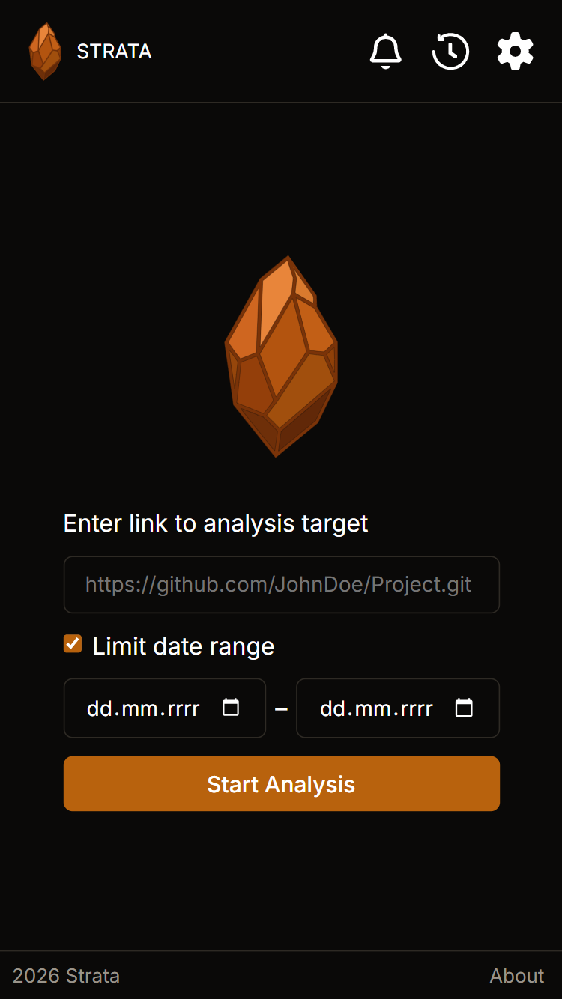
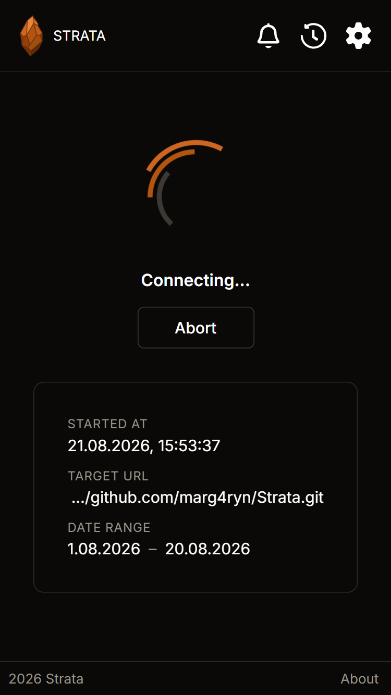
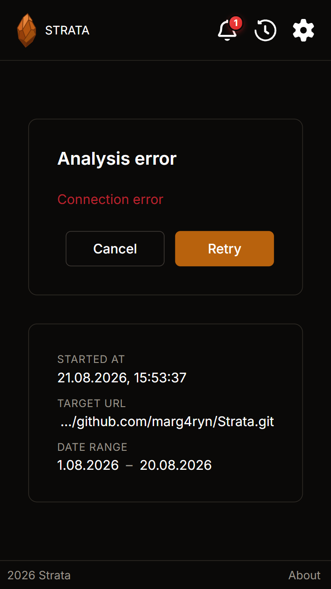
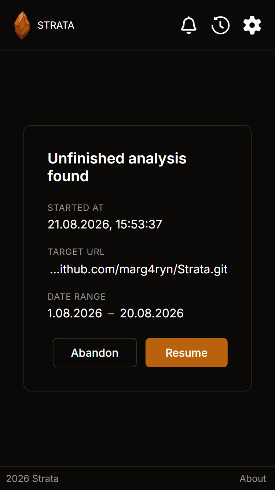
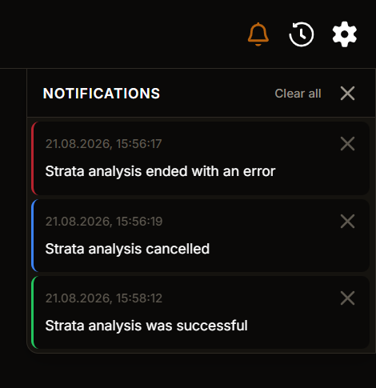
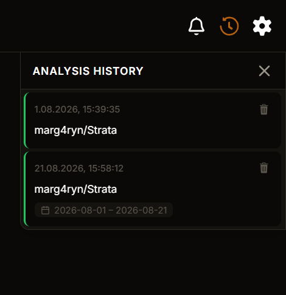
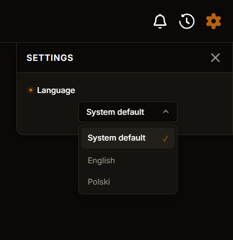

# STRATA

🔗 Backend Repository: https://github.com/marg4ryn/Strata-Backend

> Detailed project documentation can be found in the `docs/` directory. It includes Architecture Decision Record (ADR), the project structure convention, as well as activity and sequence diagrams.

## 🧭 About

**Strata** is a tool for behavioral analysis of software repositories. It uses version control history to study how a codebase evolves over time, going beyond its current state to reveal patterns of development and maintenance. By combining historical activity with structural information about the code, Strata helps identify areas that are particularly important to the evolution of a system and provides context for deciding where maintenance effort may have the greatest impact.

The application's name refers to rock strata – layers that accumulate over time and record the processes that shaped them. In software, these layers are the successive changes recorded in version control, preserving a history of how the system was developed. By examining this history, Strata can reveal **hotspots** – areas of code that are both complex and frequently modified, and therefore often deserve additional attention. Rather than replacing static analysis, Strata adds a historical perspective that helps teams understand which parts of a system matter most in practice and make better-informed decisions about its development and maintenance.

## ✨ Features

### Running Analyses

To start an analysis, the user provides the URL of the target Git repository. Optionally, they can specify a date range to limit the analysis; otherwise, the repository's entire commit history is processed by default (see the **Target Form** below). During the analysis, the application displays real-time progress updates delivered by the server over a WebSocket connection, allowing users to monitor each stage of the process (see the **Loading Screen** below). Multiple analyses can be executed simultaneously in separate tabs, enabling users to work on different repositories independently. Application state is synchronized across browser tabs using Local Storage, while the Web Locks API prevents multiple tabs from competing for the same resources, ensuring consistent and reliable behavior.

If an error occurs or the WebSocket connection is interrupted, the application allows the user to reconnect and resume receiving status updates without restarting the analysis (see the **Analysis Error** below). An analysis continues running even if the application is closed. When the user returns later, Strata automatically detects any unfinished analysis and offers the option to reconnect to it (see the **Unfinished Analysis** below). 

| Target Form | Loading Screen | Analysis Error | Unfinished Analysis |
|:---:|:---:|:---:|:---:|
|  |  |  |  |

### Additional Features

Users can access several application panels directly from the header. All panels are implemented using Angular CDK Overlay, which keeps them independent from the main application layout while providing consistent behavior and accessibility.

Important actions trigger notifications that inform users about the result of an operation. Notifications indicate the message type (`success`, `info`, `warn`, or `error`) and the number of unread notifications is displayed in the application header (see the **Notifications** below).

Each successfully completed analysis is added to the analysis history. Users can open a previous entry to load its results without having to run the analysis again (see the **Analysis History** below). The analysis history state is synchronized between browser tabs using the Broadcast Channel API, ensuring that additions and removals made in one tab are reflected in the others.

The settings panel allows users to change the application language between English and Polish. Translations are handled at runtime using Transloco, allowing the language to be changed without reloading the application (see the **Settings** below). Dates and numbers are localized at display time using custom pipes, which format the values according to the currently selected application language provided by Transloco.

| Notifications | Analysis History | Settings |
|:---:|:---:|:---:|
|  |  |  |

## 🏙️ Code City Rendering

### Layout

Before rendering, the city is laid out bottom-up: each folder packs its children onto a platform, and that platform then becomes a single rectangle inside its parent. Packing uses a greedy guillotine algorithm based on potpack: children go in tallest first, each one into the smallest free space that fits it, with a fixed margin around every rectangle. A short sweep over eight container widths keeps the layout that wastes the least area while staying close to square, and elongated child folders are rotated by 90° when that makes their parent smaller. The layout is deterministic, so the same repository always produces the same city, and it takes milliseconds even for large trees (see `docs/architecture-decision-record.md` – *Why guillotine packing?*).

### Performance

Repositories can contain thousands of files, so the Code City is built to keep the number of GPU objects and draw calls constant, no matter how large the city gets. Buildings and platforms all reuse a single shared `UNIT_CUBE` (a unit `BoxGeometry`) and differ only by their transform matrix and color. The renderer creates one `InstancedMesh` per type (buildings, platforms and edges), so the GPU draws each type as a single batch instead of issuing a draw call for every node. Edges are instances of a shared, low-detail cylinder.

The CPU computes all instance matrices once per city, and after that the geometry stays static. Each frame, Three.js passes only the updated camera matrices to the GPU, where the vertex shader projects every instance into screen space. Rotating, zooming or panning therefore costs no geometry rebuilds and no buffer uploads. Picking is just as cheap: instead of keeping a scene object per file, a raycaster tests the pointer against the instanced meshes, and an instance map translates the hit back to its repository node.

GPU memory is released explicitly. Build buffers are local to each `GeometryBuilder.build` call, and a failed build rolls back the instance map and disposes of any meshes it already created. Replacing the city or destroying the component disposes of its meshes and scene resources. Only the shared `UNIT_CUBE` is kept alive, because every city reuses it.

### Code City Shell

The Code City Shell renders `<app-code-city>` outside the `<router-outlet>` that displays pages such as Hotspots, File Types and Code Age. Switching between these child routes replaces only the page content: the city component stays mounted, so its Three.js scene and GPU resources are reused. The scene is rebuilt only when the repository tree itself changes.

Each page provides its sidebar content as an Angular template. A directive registers that `TemplateRef` in `CodeCityStateService`, and the shell displays it with `NgTemplateOutlet`. The service is provided by the shell, so its signals are shared by the shell, active page, search bar, repository explorer and city without becoming application-wide state.

The shell passes the city tree and color data to the city as inputs. Two-way `model` bindings connect the `selectedNodePath`, `hoveredNodePath` and `keyboardNavigationActive` signals to the search bar, repository explorer and city. For example, selecting a search result selects the matching instance in the city and the same node in the explorer. The active page writes its visualization colors to the shared `colorData` signal, which updates instance colors without rebuilding geometry. Auto-rotation is controlled separately by a shell-local signal and the pause/play button.

## 🧪 Tests

The application is tested using the Vitest + Istanbul stack. Unit tests are used wherever possible. However, components that embed child components are tested using integration tests to avoid losing code coverage (see `docs/architecture-decision-record.md` – *Why do component tests use real child components instead of stubs?*).

## 🤖 AI

The application wasn't vibe-coded, but AI definitely helped me along the way. ChatGPT saved me a lot of time when generating documentation. Copilot helped me track down the cause of several frustrating component layout bugs (missing `min-width: 0`). Claude, on the other hand, generated solid test files and SCSS and supported me while learning Angular.

This is my first Angular project and, at the same time, my playground for learning the technology. Claude acts as a mentor here, helping me especially with the areas I find the most challenging: Angular CDK Overlay and writing component tests. I'm still learning both, and I plan to keep building my skills and exploring Angular further.
